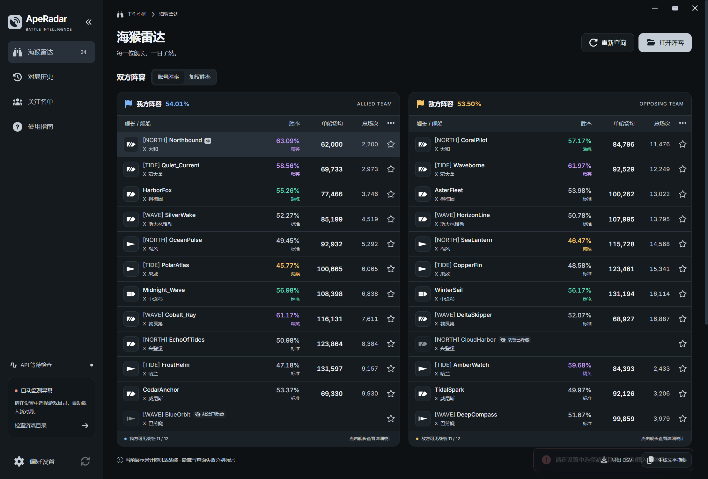

# ApeRadar Next

基于 ApeRadar 发布包机制研究，用 **React + Vite + Tailwind CSS + Electron + Node.js + TypeScript + SQLite** 实现的桌面重写版。包管理器统一为 **pnpm**。



## 启动

开发环境需要 Node.js 24+ 与 pnpm 10.34.6。Electron 内置自己的 Node.js，使用生成后的 Windows 应用不需要另外安装 Node、SQLite 或 .NET。

```powershell
pnpm install --frozen-lockfile
pnpm dev
```

`pnpm dev` 构建主进程与 preload，启动 Vite，并打开 Electron 窗口。React 界面支持热更新；修改主进程/preload 后重新启动此命令。

只在浏览器调试同一套完整界面和本地服务：

```powershell
pnpm dev:web
```

访问 `http://127.0.0.1:5173`。浏览器预览使用同源开发接口和真实 SQLite，不是静态截图；文件夹选择、原生窗口控制与系统剪贴板桥仅在桌面进程提供。

## 使用

1. Open Settings → Game connection. The app discovers current WGC and Steam clients and validates the selected installation. AUTO uses the active server in game preferences and recent startup logs; choose a region manually if evidence is unavailable or conflicting.
2. Monitoring starts automatically and follows the configured game directory. A monitoring notice appears only when attention is needed. You can also use 「打开阵容」 or drag in `tempArenaInfo.json` / `.wowsreplay` to import a lineup manually.
3. 查询结果逐位更新。阵容保留游戏文件中的原始顺序，可搜索舰长/船名、筛选舰种、切换账号/加权胜率，并打开详细统计。
4. 点击星标维护本地关注与备注。在历史页回看快照，或主动导出 CSV、生成文字摘要。

真实导入默认自动查询。设置中可以关闭此项，在离线环境先检查阵容。

## 已实现

- 阵容 JSON 与回放首块读取，正确处理 UTF-8 字节长度、BOM、空白和不完整文件。
- 亚/美/欧/俄服，以及按阵营分配区服的混合房间。
- Vortex、WG 公共 API。WG 使用批量昵称、账号、军团查询；俄服自动使用 Vortex。
- 全局请求并发上限、启动间隔、超时、429/5xx 退避、逐玩家错误恢复和取消。
- SQLite 设置、对局快照、关注名单与有时效的战绩缓存；参数化 SQL 与 WAL。
- 已验证的胜率算法、精英/海猴阈值、双方均值和升序胜率折线图。缺数据、隐藏与错误分别呈现。
- 浅色/深色/系统主题、名称遮蔽、可编辑摘要和 CSV 导出。
- Radix 焦点管理、Escape 关闭详情并恢复焦点、固定阵容顺序、键盘操作、375px 到桌面的响应布局。
- Electron 沙箱、隔离 preload、有限类型桥、IPC 来源检查和自定义本地资源协议。

## API configuration

Edit [config/api.json](config/api.json) to configure the WG Application ID, regional WG/Vortex
endpoints, timeouts, concurrency, request spacing, and health-check interval. Restart the application
after editing. Development uses this file directly; production desktop builds create an editable
`api-config.json` alongside the user-data database. `APERADAR_CONFIG_FILE` selects another file and
`WG_APPLICATION_ID` overrides its ID. See [API configuration](docs/api-configuration.md) for precedence
and Settings behavior.

## 评分口径

默认账号基线：

```text
A = (5 × 单排胜场 + 2 × 双排胜场 + 三排胜场)
    / (5 × 单排场次 + 2 × 双排场次 + 三排场次)
w = 20% × min(本舰场次 / 60, 1)
加权胜率 = A × (1 − w) + 本舰胜率 × w
```

本舰零场时直接回退账号总胜率。新版本也对零有效模式权重和缺失本舰统计作回退，避免传播 NaN。默认海猴为 ≤47%，精英为 >58% 且账号 ≥500 场。队伍均值是可见账号的等权平均；图表与均值都不是本场胜负预测。

## 开发命令

| 命令 | 作用 |
|---|---|
| `pnpm dev` | Vite + Electron 桌面开发 |
| `pnpm dev:web` | 浏览器预览，附真实本地服务 |
| `pnpm typecheck` | 完整 TypeScript 检查 |
| `pnpm test` | 解析、算法、SQLite、网络边界与生命周期测试 |
| `pnpm test:api:live` | Validate live regional APIs using `config/api.json`, optionally overridden by `WG_APPLICATION_ID` |
| `pnpm ships:update` | Refresh the bundled bilingual ship catalog using the WG encyclopedia API |
| `pnpm ships:update --names-only` | Restore original Chinese ship names in the local catalog without network access |
| `pnpm check` | 类型检查、核心测试与设计令牌检查 |
| `pnpm build` | 生产界面与 Electron 主进程/preload |
| `pnpm build:web` | 单独构建浏览器界面 |
| `pnpm build:desktop` | 单独构建主进程/preload（运行前还需 build:web） |
| `pnpm smoke:desktop` | 隐藏真实 Electron 窗口验证，输出浅色/深色截图 |
| `pnpm run pack` | 生成 Windows 应用目录 |
| `pnpm dist:win` | 生成 Windows x64 安装版与单文件便携版 |
| `pnpm verify:updates` | 校验更新清单、安装包哈希、大小及配套发布文件 |
| `pnpm verify:package` | 对实际便携版执行隐藏集成验证 |

Portable executable: `release/ApeRadar-Next-1.0.3-x64.exe`; Windows installer: `release/ApeRadar-Next-Setup-1.0.3-x64.exe`; unpacked application: `release/win-unpacked/`. The Windows executables are unsigned. Cache and packaging directories are excluded from Vite file watching to avoid Windows file locks and unrelated page reloads during packaging.

打包、安装和更新流程沿用 [brokenarrow-log-maggot](https://github.com/JamesFlare1212/brokenarrow-log-maggot)，发布源为本项目的 GitHub Releases。桌面版启动 15 秒后检查更新，此后每 4 分钟检查一次；左下角按钮依次提供检查、下载、圆环进度和重启安装，便携版发现更新后打开下载页。查询期间暂缓安装，浏览器预览和开发版会显示不可用原因。

所有工作区包使用一致的正式版本号，推送匹配的 `v<版本>` 标签后，GitHub Actions 自动检查、打包、验证并发布 EXE、`latest.yml` 和 `.blockmap`；手动运行工作流仅生成可下载产物。本地打包不会上传。发布步骤与验证范围见 [Application updates](docs/application-updates.md)。

Windows 目录打包使用 `pnpm run pack`；`pnpm pack` 是 pnpm 自带的 npm tarball 打包命令。

## 目录与数据

```text
apps/
  desktop/              Electron 主进程、隔离 preload、桌面构建与验证脚本
    src/                main.ts / preload.ts
    build/              Windows 打包图标
    resources/          Font Awesome 应用图标
    electron-builder.json Windows 打包配置
  server/               SQLite、文件监测、API 与查询生命周期
    src/                领域服务与浏览器开发接口
    resources/          Bundled bilingual ship catalog
  web/                  React + Vite 浏览器界面
    src/                页面、组件与类型桥
    public/             静态资源
    assets/             三层设计令牌
packages/
  shared/               领域类型、运行时校验、评分与摘要
tests/                  跨包离线测试与模拟响应
scripts/                工作区设计令牌检查
design-system/          设计系统 Master
docs/                   架构与验证说明
artifacts/              桌面截图和实际验证记录
release/                Windows 打包输出（忽略提交）
analysis/               既有 REA 调查，不参与应用运行或打包
```

目录边界参考 [T3 Code 的 apps 结构](https://github.com/pingdotgg/t3code/tree/main/apps)，采用 pnpm workspace。每个应用与共享包有自己的 `package.json` 和 `tsconfig.json`，公共 TypeScript 选项放在根目录 `tsconfig.base.json`。跨包引用统一通过 `@aperadar/server/*`、`@aperadar/shared/*` 与 `workspace:*` 声明；共享包直接导出 TypeScript 源码，由 Vite/esbuild 打包。

`web` 的浏览器代码只依赖 `shared`；Vite 开发配置挂载 `server`。`desktop` 使用 `server` 与 `shared`，生产时把服务和校验依赖打入主进程。界面输出到 `apps/web/dist/`，主进程输出到 `apps/desktop/dist-electron/`；打包时将界面、船表、图标和版权声明汇入应用，无需复制源码或依赖研究目录。

生产数据位于 Electron `userData/aperadar.sqlite`，设置页显示完整位置。开发浏览器服务的数据位于 `.data/web/aperadar.sqlite`。测试使用独立 `.test-data/` 目录；不读用户真实游戏数据，不更改原发布包。

正常关闭应用后可复制数据库备份。运行期间 SQLite 可能有 `-wal` 与 `-shm` 文件，应由 SQLite 自身或关闭进程后的文件备份保持一致。

## 边界与验证

核心测试使用模拟 HTTP 响应，桌面与便携版验证使用合成阵容。线上 API 可按需单独验证：

```powershell
pnpm test:api:live
```

线上验证调用现有健康检查与查询实现，检查四个海外区服的路由，以及美/欧/亚官方接口的搜索、账号、军团、单船和四类统计字段；对可连接的 Vortex 额外检查完整查询。官方链路失败时退出码为 1；Vortex 的部分详情失败单独记为 `partial`，不代表完整通过。报告保留请求状态与诊断，省略完整应用 ID、玩家昵称及账号 ID。不会修改应用设置、玩家缓存或历史，不随 `pnpm test` 自动联网。

2026-10-16 已使用用户提供的应用 ID 完成线上验证，并修复 Vortex 搜索路径缺少末尾斜杠导致的 308 失败。未用原日志中的私人玩家身份进行在线查询；服务可用性会随时间、区域和网络环境变化。没有实现旧版 HTTP 自动覆盖更新、第三方整场上传或模拟聊天发送。

验证详情见 [docs/verification.md](docs/verification.md)；架构见 [docs/architecture.md](docs/architecture.md)；界面规范见 [设计系统 Master](design-system/aperadar-next/MASTER.md)。

技术实现参考 [Electron 上下文隔离](https://www.electronjs.org/docs/latest/tutorial/context-isolation)、[安全建议](https://www.electronjs.org/docs/latest/tutorial/security)、[Node SQLite API](https://nodejs.org/api/sqlite.html) 与 [Tailwind Vite 集成](https://tailwindcss.com/docs/installation/using-vite)。

The initial ship catalog came from the original MIT distribution. Current entries are refreshed through the WG Public API, retaining legacy entries absent from the API. Missing ships are fetched in the background and persisted locally. See [Ship catalog maintenance](docs/ship-catalog.md), [LICENSE](LICENSE), and [THIRD_PARTY_NOTICES.txt](THIRD_PARTY_NOTICES.txt) for maintenance and attribution. This is an independent community project.
